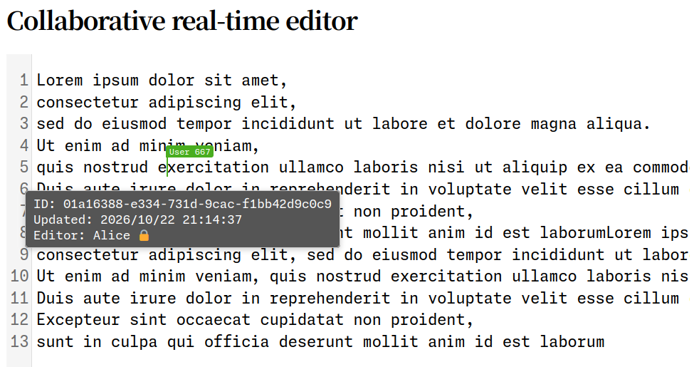

# codemirror/collabの概念実証

- 共同編集者のカーソル同期
- 実ファイルと編集バッファの双方向同期
- 認可されたプロキシサーバを介した共同編集
- 行IDの割り当て
- 各行の最終更新者のデジタル署名とブラウザ検証




```sh
# relay 側: 鍵を作る。公開鍵の1行が表示される
./myapp keygen

# メイン側: authorized_keys にその1行を追記して起動
echo 'ssh-ed25519 AAAA... ' >> authorized_keys
./myapp serve --addr 0.0.0.0:3002

# relay 側: メインが書き出した known_hosts をコピーして起動
cp <メインのディレクトリ>/known_hosts .
./myapp relay --upstream ws://127.0.0.1:3002 --addr 127.0.0.1:3004
```

